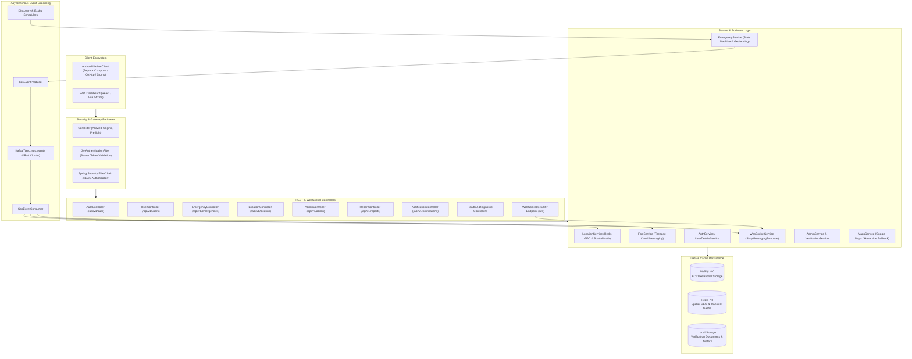
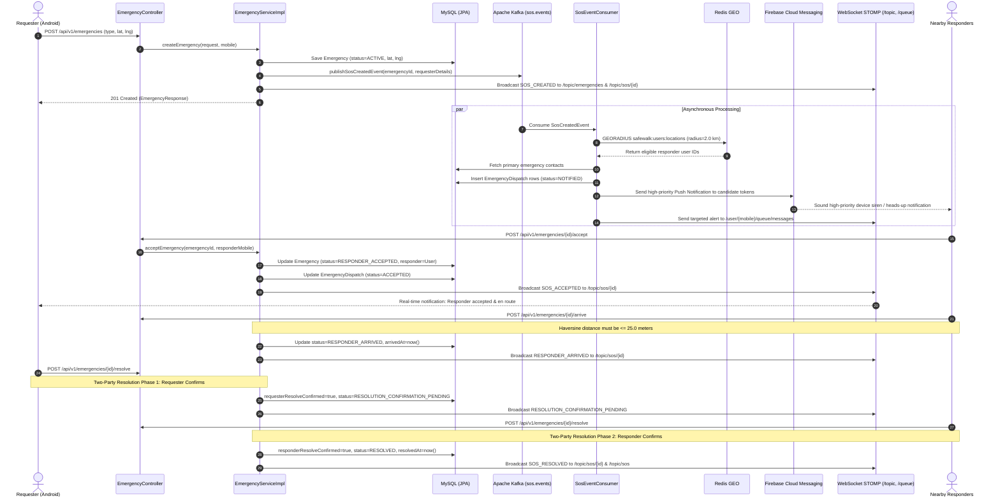
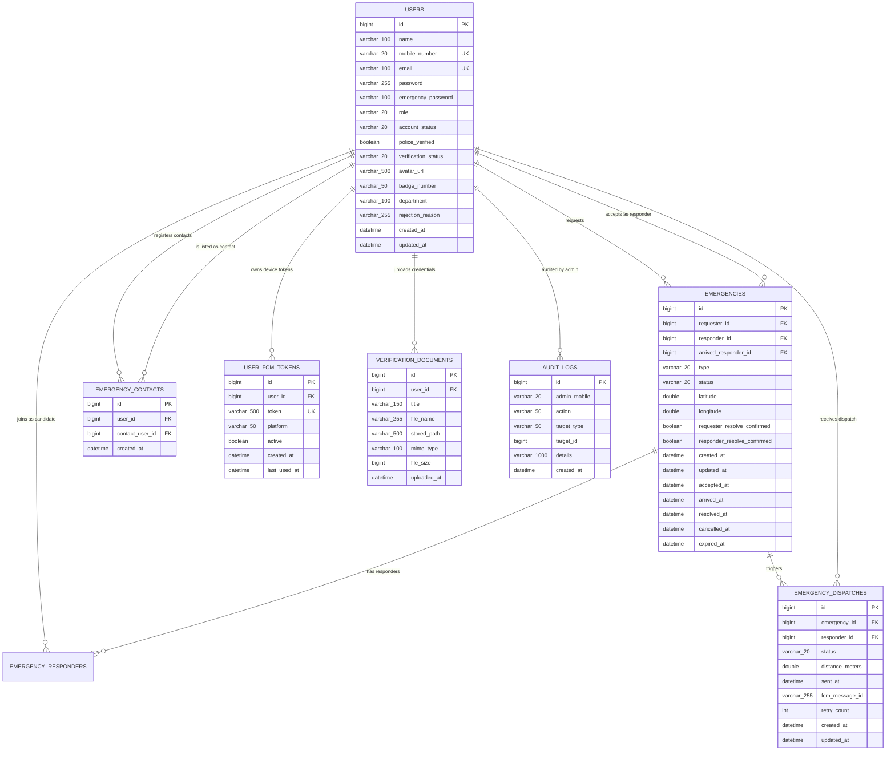
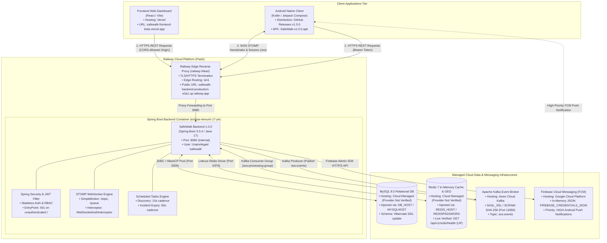

# SafeWalk Backend — Real-Time Emergency & Safety Assistance Platform

[](https://openjdk.org/projects/jdk/17/)
[](https://spring.io/projects/spring-boot)
[](https://maven.apache.org/)
[](https://www.mysql.com/)
[](https://redis.io/)
[](https://kafka.apache.org/)
[](https://www.docker.com/)
[](https://firebase.google.com/)
[](https://docs.spring.io/spring-framework/reference/web/websocket.html)
[](https://junit.org/junit5/)

SafeWalk is a distributed, event-driven real-time emergency safety and community response backend platform. Engineered with Java 17 and Spring Boot 3.3.4, the system powers instantaneous SOS alert dispatching, geospatial candidate discovery via Redis GEO, sub-second WebSocket STOMP updates, asynchronous event streaming through Apache Kafka (KRaft mode), Firebase Cloud Messaging (FCM) high-priority push notifications, multi-role RBAC security, and verification workflows for police and healthcare personnel.

---

## 📌 Project Links & Ecosystem

| Component | Target / Resource | Link |
| :--- | :--- | :--- |
| **Android Application** | Mobile Client Repository | [SafeWalk-Android (GitHub)](https://github.com/gauravto312-wq/SafeWalk-Android) |
| **Android APK Release** | v1.0.0 Production Release | [v1.0.0 Release Tag](https://github.com/gauravto312-wq/SafeWalk-Android/releases/tag/v1.0.0) |
| **Android Direct APK** | Installable Android Package | [Download SafeWalk-v1.0.0.apk](https://github.com/gauravto312-wq/SafeWalk-Android/releases/download/v1.0.0/SafeWalk-v1.0.0.apk) |
| **Live Platform Demo** | End-to-End Walkthrough Video | [Watch Demo on YouTube](https://youtu.be/91b0QSqxUSY) |
| **Backend Repository** | Core Spring Boot Source Code | [safewalk-backend (GitHub)](https://github.com/gauravto312-wq/safewalk-backend) |
| **Frontend Web Client** | Web Dashboard Repository | `[Frontend repository URL — to be added]` |
| **Deployed Web Client** | Beta Web Dashboard (Vercel) | [safewalk-frontend-beta.vercel.app](https://safewalk-frontend-beta.vercel.app) |
| **Production API Base** | Cloud Deployment Base URL (Railway) | [safewalk-backend-production-e3a1.up.railway.app](https://safewalk-backend-production-e3a1.up.railway.app) |

---

## 📖 Table of Contents

- [SafeWalk Backend — Real-Time Emergency \& Safety Assistance Platform](#safewalk-backend--real-time-emergency--safety-assistance-platform)
  - [📌 Project Links \& Ecosystem](#-project-links--ecosystem)
  - [📖 Table of Contents](#-table-of-contents)
  - [1. Architecture \& Request Lifecycle](#1-architecture--request-lifecycle)
    - [1.1 Layered System Architecture](#11-layered-system-architecture)
    - [1.2 Event-Driven SOS Dispatch Sequence](#12-event-driven-sos-dispatch-sequence)
    - [1.3 Core State Machines \& Safety Windows](#13-core-state-machines--safety-windows)
  - [2. Technology Stack \& Library Matrix](#2-technology-stack--library-matrix)
  - [3. Core Features \& Implementation Details](#3-core-features--implementation-details)
  - [4. Project Structure \& Package Architecture](#4-project-structure--package-architecture)
  - [5. Database Design \& Persistence Architecture](#5-database-design--persistence-architecture)
    - [5.1 Entity-Relationship Model](#51-entity-relationship-model)
    - [5.2 Relational Tables (MySQL 8.0)](#52-relational-tables-mysql-80)
    - [5.3 In-Memory Geospatial \& Cache Architecture (Redis 7)](#53-in-memory-geospatial--cache-architecture-redis-7)
  - [6. Complete REST API Specification](#6-complete-rest-api-specification)
    - [6.1 Authentication \& Registration (`/api/v1/auth`)](#61-authentication--registration-apiv1auth)
    - [6.2 User Profile, Contacts \& Verification (`/api/v1/users`)](#62-user-profile-contacts--verification-apiv1users)
    - [6.3 Emergency Lifecycle Management (`/api/v1/emergencies`)](#63-emergency-lifecycle-management-apiv1emergencies)
    - [6.4 Geospatial \& Location Services (`/api/v1/location`)](#64-geospatial--location-services-apiv1location)
    - [6.5 Device Tokens \& Notifications (`/api/v1/notifications`)](#65-device-tokens--notifications-apiv1notifications)
    - [6.6 Administrative Control Plane (`/api/v1/admin`)](#66-administrative-control-plane-apiv1admin)
    - [6.7 Incident Analytics \& Reporting (`/api/v1/reports`)](#67-incident-analytics--reporting-apiv1reports)
    - [6.8 Health, Telemetry \& Diagnostics](#68-health-telemetry--diagnostics)
    - [6.9 Representative API Payload Contracts](#69-representative-api-payload-contracts)
  - [7. Real-Time WebSocket \& STOMP Specification](#7-real-time-websocket--stomp-specification)
    - [7.1 Two-Stage Authentication Protocol](#71-two-stage-authentication-protocol)
    - [7.2 Destination Hierarchy](#72-destination-hierarchy)
  - [8. Android Application Integration Guide](#8-android-application-integration-guide)
  - [9. Frontend Web Integration Guide](#9-frontend-web-integration-guide)
  - [10. Local Development Setup](#10-local-development-setup)
    - [10.1 Prerequisites](#101-prerequisites)
    - [10.2 Clone and Configure Environment](#102-clone-and-configure-environment)
    - [10.3 Option A: Launching via Docker Compose (Recommended)](#103-option-a-launching-via-docker-compose-recommended)
    - [10.4 Option B: Local Native Run (Maven + Hybrid Containers)](#104-option-b-local-native-run-maven--hybrid-containers)
  - [11. Environment Variables Reference](#11-environment-variables-reference)
  - [12. Docker Architecture \& Container Infrastructure](#12-docker-architecture--container-infrastructure)
  - [13. Production Deployment Architecture, Topology \& Health Checks](#13-production-deployment-architecture-topology--health-checks)
    - [13.1 Deployment Component \& Hosting Topology](#131-deployment-component--hosting-topology)
    - [13.2 Verified Deployment Architecture Diagram](#132-verified-deployment-architecture-diagram)
    - [13.3 Real-World Production Deployment Workflow](#133-real-world-production-deployment-workflow)
    - [13.4 Deployed API \& Health Check Verification](#134-deployed-api--health-check-verification)
  - [14. Automated Testing \& Verification Quality](#14-automated-testing--verification-quality)
  - [15. Troubleshooting \& Operational Runbook](#15-troubleshooting--operational-runbook)
  - [16. Security, Hardening \& Compliance Review](#16-security-hardening--compliance-review)
  - [17. Project Roadmap \& Engineering Limitations](#17-project-roadmap--engineering-limitations)
  - [18. Authors \& Engineering Credits](#18-authors--engineering-credits)

---

## 1. Architecture & Request Lifecycle

### 1.1 Layered System Architecture



---

### 1.2 Event-Driven SOS Dispatch Sequence



---

### 1.3 Core State Machines & Safety Windows

1. **5-Second SOS Cancellation Window**:
   - Requesters can cancel an emergency within **5.0 seconds** of creation (`POST /api/v1/emergencies/{id}/cancel`).
   - If cancelled within this grace window, active dispatches are recalled, and status transitions directly to `CANCELLED`.
   - After the 5-second window elapses or once a responder has accepted/arrived, cancellation requires administrative override or explicit mutual resolution.
2. **25-Meter Arrival Gate**:
   - Responders cannot mark arrival (`POST /api/v1/emergencies/{id}/arrive`) until their GPS coordinates are verified to be within **$\le 25.0\text{ meters}$** of the requester's coordinates using the Haversine spatial calculation formula.
3. **Two-Party Mutual Resolution Protocol**:
   - Resolving an emergency requires independent confirmation from **both** the requester and the arrived responder.
   - Confirmation 1: Sets `status = RESOLUTION_CONFIRMATION_PENDING` and alerts the counterpart via WebSocket.
   - Confirmation 2: Transitions status to `RESOLVED`, sets `resolvedAt`, stops location streaming, and closes the incident.
4. **Automated 5-Hour Expiry**:
   - Handled by `EmergencyExpiryScheduler` running at startup and periodically every 60 seconds. Active incidents exceeding 5 hours without updates are safely expired to prevent stale spatial locks.
5. **Continuous 15-Second Responder Discovery**:
   - Handled by `EmergencyDiscoveryScheduler` running every 15 seconds. If candidate responders move into the 2.0 km radius after the initial dispatch, the scheduler identifies them and delivers deduplicated FCM dispatches.

---

## 2. Technology Stack & Library Matrix

| Category | Technology / Library | Version | Purpose in Architecture | Configuration / Class Reference |
| :--- | :--- | :--- | :--- | :--- |
| **Language** | OpenJDK / Java | `17` | Core application runtime and LTS platform | `pom.xml` (`<java.version>17</java.version>`) |
| **Framework** | Spring Boot | `3.3.4` | Application container, auto-configuration, MVC, and DI | `pom.xml` (`spring-boot-starter-parent`) |
| **Security** | Spring Security | `6.1.13` *(managed)* | Stateless HTTP filter chain, method security, and CORS | [`SecurityConfig.java`](src/main/java/com/safewalk/config/SecurityConfig.java) |
| **Tokens** | JJWT (io.jsonwebtoken) | `0.12.6` | HMAC-SHA256 JWT generation, signing, and parsing | [`JwtTokenProvider.java`](src/main/java/com/safewalk/security/JwtTokenProvider.java) |
| **Persistence** | Spring Data JPA / Hibernate | `3.3.4` *(managed)* | Object-relational mapping, repositories, transactions | `application.yml` (`spring.jpa.*`) |
| **Database** | MySQL | `8.0` | Production ACID relational database | `application.yml` (`spring.datasource.*`) |
| **Cache & GEO** | Spring Data Redis (Lettuce) | `3.3.4` *(managed)* | Geospatial indexing (`GEOADD`, `GEORADIUS`), key expiry | [`RedisConfig.java`](src/main/java/com/safewalk/config/RedisConfig.java) |
| **Messaging** | Apache Kafka (KRaft mode) | `3.7.0` *(broker)* | Distributed streaming of emergency creation events | [`KafkaConfig.java`](src/main/java/com/safewalk/config/KafkaConfig.java) |
| **Push Alerts** | Firebase Admin Java SDK | `9.3.0` | High-priority FCM push notification dispatching | [`FirebaseConfig.java`](src/main/java/com/safewalk/config/FirebaseConfig.java) |
| **WebSockets** | Spring WebSocket / STOMP | `3.3.4` *(managed)* | Pub/sub broadcast channels and private user queues | [`WebSocketConfig.java`](src/main/java/com/safewalk/config/WebSocketConfig.java) |
| **Build Tool** | Apache Maven | `3.9+` | Build lifecycle, dependency resolution, packaging | `pom.xml` |
| **Container** | Docker & Docker Compose | Compose v2 | Multi-stage container build and multi-service topology | `Dockerfile`, `docker-compose.yml` |
| **Testing** | JUnit Jupiter & Mockito | `5.10.3` *(managed)* | Unit, integration, security, and controller slicing | `src/test/java/com/safewalk/...` (317 tests across 41 classes) |
| **In-Memory DB**| H2 Database | `2.2.224` *(managed)*| Transient relational database used in automated tests | `pom.xml` (`scope: test`) |

---

## 3. Core Features & Implementation Details

- **Stateless JWT Authentication**: Dual-identifier login supporting either mobile number or email. Passwords hashed using Spring Security's `BCryptPasswordEncoder` (strength 10).
- **Role-Based Access Control (RBAC)**: Enforced via Spring Security `SecurityFilterChain` and `@PreAuthorize` method security supporting `ROLE_USER`, `ROLE_RESPONDER`, `ROLE_POLICE`, `ROLE_HOSPITAL`, and `ROLE_ADMIN`.
- **Operator Admin Bootstrap Runner**: Self-contained [`AdminBootstrapRunner`](src/main/java/com/safewalk/config/AdminBootstrapRunner.java) executing on application startup. Validates environment configurations, checks email/mobile uniqueness, and provisions initial administrator accounts idempotently without hardcoded secrets.
- **High-Performance Geospatial Engine**: Real-time user coordinates are indexed in Redis GEO sorted sets (`safewalk:users:locations`). Queries nearby qualified responders within configurable radiuses (default 2.0 km) with coordinate freshness checks (5-minute TTL).
- **External Maps & Haversine Distance Engine**: [`MapsServiceImpl`](src/main/java/com/safewalk/service/impl/MapsServiceImpl.java) integrates with Google Maps Distance Matrix and Geocoding APIs when configured, falling back automatically to the mathematical **Haversine formula** and reverse coordinate mapping when keys are omitted.
- **Asynchronous Event Pipeline**: Emergency dispatches are offloaded to an Apache Kafka KRaft cluster via topic `sos.events`, guaranteeing database transaction isolation and sub-100ms response times for emergency creation calls.
- **Live WebSocket STOMP Messaging**: Intercepted by [`WebSocketAuthInterceptor`](src/main/java/com/safewalk/security/WebSocketAuthInterceptor.java). Dispatches incident broadcasts to `/topic/sos/{id}` and targeted responder notices to `/user/queue/messages`.
- **Hybrid Firebase Cloud Messaging**: [`FirebaseConfig`](src/main/java/com/safewalk/config/FirebaseConfig.java) supports two credential injection modes:
  1. Standard file path mount (`GOOGLE_APPLICATION_CREDENTIALS`).
  2. Cloud in-memory JSON string (`FIREBASE_CREDENTIALS_JSON`), enabling cloud providers like Railway to run live FCM without persistent file volume attachments.
  3. Automatic graceful fallback to **DEV Simulation Mode** during local offline development.
- **Identity Document Verification**: Multi-part document upload (`/api/v1/users/me/verification-documents`) with MIME type gating (`application/pdf`, `image/jpeg`, `image/png`), portable UUID path storage, and secure administrative preview streaming preventing Insecure Direct Object References (IDOR).
- **Two Emergency Contacts Ceiling**: Enforces maximum of two registered emergency contacts per user account with reciprocal contact lookup during SOS triggering.

---

## 4. Project Structure & Package Architecture

```text
com.safewalk
├── SafeWalkApplication.java             # Spring Boot main application entrypoint
├── config/                              # Infrastructure and framework configuration
│   ├── AdminBootstrapRunner.java        # CommandLineRunner for initial admin account initialization
│   ├── CorsConfig.java                  # Dual CorsConfigurationSource and WebMvcConfigurer
│   ├── FirebaseConfig.java              # Dual-mode Firebase Admin SDK initializer
│   ├── KafkaConfig.java                 # Producer/Consumer factories and topic definitions
│   ├── RedisConfig.java                 # RedisConnectionFactory and RedisTemplate configuration
│   ├── SecurityConfig.java              # Spring Security FilterChain, CORS, and endpoint rules
│   └── WebSocketConfig.java             # STOMP message broker and endpoint registrations
├── controller/                          # REST API and WebSocket web controllers (10 classes)
│   ├── AdminController.java             # Admin dashboard, audit logs, and user management
│   ├── AuthController.java              # Public registration and login endpoints
│   ├── EmergencyController.java         # SOS lifecycle, cancellation, and resolution
│   ├── HealthController.java            # Primary container health check endpoint
│   ├── LocationController.java          # GPS updates, reverse geocoding, and nearby queries
│   ├── NotificationController.java      # FCM device token management and testing
│   ├── RedisHealthController.java       # Read/write Redis diagnostic endpoint
│   ├── ReportController.java            # Statistical reports and dashboard metrics
│   ├── UserController.java              # Profile, emergency contacts, avatars, documents
│   └── WebSocketTestController.java     # WebSocket test broadcast endpoint
├── dto/                                 # Data Transfer Objects
│   ├── event/RealTimeEvent.java         # WebSocket message envelope payload
│   ├── request/                         # Request DTOs with Jakarta Validation constraints
│   └── response/                        # Standardized response envelopes and entity projections
├── entity/                              # JPA Relational Entities & Enums (13 classes)
│   ├── AccountStatus.java               # ACTIVE, WARNING, RESTRICTED, SUSPENDED, DEACTIVATED
│   ├── AuditLog.java                    # Admin audit trail entity
│   ├── DispatchStatus.java              # PENDING, NOTIFIED, ACCEPTED, REJECTED, EXPIRED, ARRIVED
│   ├── Emergency.java                   # Primary SOS incident entity
│   ├── EmergencyContact.java            # Two-party emergency contact link
│   ├── EmergencyDispatch.java           # Incident-to-responder dispatch tracking
│   ├── EmergencyStatus.java             # CREATED, ACTIVE, RESPONDER_ACCEPTED, etc.
│   ├── EmergencyType.java               # GENERAL, MEDICAL, POLICE, FIRE, ACCIDENT, HARASSMENT
│   ├── Role.java                        # USER, RESPONDER, POLICE, HOSPITAL, ADMIN
│   ├── User.java                        # Core user account entity
│   ├── UserFcmToken.java                # Registered device push notification tokens
│   ├── VerificationDocument.java        # Uploaded police/hospital credentials
│   └── VerificationStatus.java          # NONE, PENDING, VERIFIED, REJECTED
├── event/                               # Kafka event definitions, producers, and consumers
│   ├── SosCreatedEvent.java             # Kafka event payload for created emergencies
│   ├── consumer/SosEventConsumer.java   # Kafka listener handling candidate discovery and FCM
│   └── producer/SosEventProducer.java   # KafkaTemplate publisher for emergency events
├── exception/                           # Error handling & custom exceptions
│   ├── AccountStatusException.java      # Thrown when restricted/suspended users attempt actions
│   ├── DuplicateResourceException.java  # Thrown on unique constraint collisions (email/mobile)
│   ├── GlobalExceptionHandler.java      # RestControllerAdvice handling all API errors
│   ├── InvalidCredentialsException.java # Thrown on login failures
│   └── ResourceNotFoundException.java   # Thrown when requested IDs/entities do not exist
├── mapper/                              # Entity-to-DTO and DTO-to-Entity transformation mappers
│   ├── EmergencyMapper.java             # Transforms Emergency entities to EmergencyResponse DTOs
│   └── UserMapper.java                  # Transforms User entities to UserResponse DTOs
├── repository/                          # Spring Data JPA Repository interfaces (7 interfaces)
│   ├── AuditLogRepository.java
│   ├── EmergencyContactRepository.java
│   ├── EmergencyDispatchRepository.java
│   ├── EmergencyRepository.java
│   ├── UserFcmTokenRepository.java
│   ├── UserRepository.java
│   └── VerificationDocumentRepository.java
├── scheduler/                           # Automated background task schedulers
│   ├── EmergencyDiscoveryScheduler.java # 15-second continuous candidate responder discovery
│   └── EmergencyExpiryScheduler.java    # 60-second overdue emergency auto-expiry
└── service/                             # Business interfaces and implementation classes (26 classes)
    ├── AdminService.java & impl/
    ├── AuthService.java & impl/
    ├── EmergencyContactService.java & impl/
    ├── EmergencyService.java & impl/
    ├── FcmService.java & impl/
    ├── FileStorageService.java & impl/LocalFileSystemStorageService.java
    ├── LocationService.java & impl/
    ├── MapsService.java & impl/
    ├── RedisService.java & impl/
    ├── ReportService.java & impl/
    ├── UserService.java & impl/
    ├── VerificationService.java & impl/
    └── WebSocketService.java & impl/
```

---

## 5. Database Design & Persistence Architecture

### 5.1 Entity-Relationship Model



---

### 5.2 Relational Tables (MySQL 8.0)

| Table Name | Entity Class | Primary Key | Key Indexes & Unique Constraints | Description |
| :--- | :--- | :--- | :--- | :--- |
| `users` | [`User`](src/main/java/com/safewalk/entity/User.java) | `id` (AUTO_INCREMENT) | `UK: mobile_number`, `UK: email` | Master user accounts, roles, verification states, and passwords |
| `emergencies` | [`Emergency`](src/main/java/com/safewalk/entity/Emergency.java) | `id` (AUTO_INCREMENT) | `idx_emergencies_requester`, `idx_emergencies_responder`, `idx_emergencies_status`, `idx_emergencies_created_at` | Core emergency incidents, coordinates, and resolution confirmations |
| `emergency_responders` | Join Table | Composite (`emergency_id`, `responder_id`) | Foreign keys to `emergencies.id` and `users.id` | Many-to-Many mapping of all responding users attached to an SOS |
| `emergency_dispatches` | [`EmergencyDispatch`](src/main/java/com/safewalk/entity/EmergencyDispatch.java) | `id` (AUTO_INCREMENT) | `UK: uk_emergency_responder (emergency_id, responder_id)`, `idx_dispatch_status` | Tracks notifications dispatched to nearby candidates with deduplication |
| `emergency_contacts` | [`EmergencyContact`](src/main/java/com/safewalk/entity/EmergencyContact.java) | `id` (AUTO_INCREMENT) | `UK: uk_user_contact (user_id, contact_user_id)`, `idx_ec_user_id` | Maximum two verified SafeWalk contacts linked to each user |
| `user_fcm_tokens` | [`UserFcmToken`](src/main/java/com/safewalk/entity/UserFcmToken.java) | `id` (AUTO_INCREMENT) | `UK: token`, `idx_user_active (user_id, active)` | Registered Firebase device tokens for push alerts |
| `verification_documents` | [`VerificationDocument`](src/main/java/com/safewalk/entity/VerificationDocument.java) | `id` (AUTO_INCREMENT) | `FK: user_id` | Metadata for police badge, hospital accreditation, or identity files |
| `audit_logs` | [`AuditLog`](src/main/java/com/safewalk/entity/AuditLog.java) | `id` (AUTO_INCREMENT) | `idx_audit_admin`, `idx_audit_target (target_type, target_id)`, `idx_audit_created_at` | Immutable administrative audit log tracking status transitions |

*Note on Hibernate DDL Auto:* The backend configures `spring.jpa.hibernate.ddl-auto: update`, which updates schema structures automatically during application startup.

---

### 5.3 In-Memory Geospatial & Cache Architecture (Redis 7)

| Key Pattern | Redis Data Structure | TTL | Purpose | Access Pattern |
| :--- | :--- | :--- | :--- | :--- |
| `safewalk:users:locations` | Geospatial Sorted Set (`GEOADD`) | Permanent | Global spatial coordinates for all online users and responders | `GEOADD`, `GEOPOS`, `GEORADIUSBYMEMBER` / `GEORADIUS` |
| `safewalk:users:location_timestamp:{userId}` | String (Epoch Seconds) | 300 seconds (5 min) | Freshness tracking timestamp. Users with expired timestamps are excluded | `SET ... EX 300`, `GET` |
| `health:test:*` | String | 60 seconds | Automated diagnostic write/read/TTL verification | `SETEX 60`, `GET`, `DEL` |

---

## 6. Complete REST API Specification

All API endpoints return a standardized JSON response envelope:
```json
{
  "success": true,
  "message": "Operation completed successfully",
  "data": { ... },
  "timestamp": "2026-10-20T12:00:00"
}
```
In error scenarios, the envelope maps to `ErrorResponse`:
```json
{
  "success": false,
  "message": "Error description message",
  "errors": { "field": "Validation message" },
  "path": "/api/v1/resource",
  "timestamp": "2026-10-20T12:00:00"
}
```

---

### 6.1 Authentication & Registration (`/api/v1/auth`)

| Method | Endpoint | Purpose | Auth | Role | Request Payload | Response Data |
| :--- | :--- | :--- | :--- | :--- | :--- | :--- |
| `POST` | `/api/v1/auth/register` | Register a new citizen, police, or hospital account | None | Public | `RegisterRequest` | `AuthResponse` (JWT token + profile) |
| `POST` | `/api/v1/auth/login` | Authenticate using mobile or email and password | None | Public | `LoginRequest` | `AuthResponse` (JWT token + profile) |

---

### 6.2 User Profile, Contacts & Verification (`/api/v1/users`)

| Method | Endpoint | Purpose | Auth | Role | Request / Params | Response Data |
| :--- | :--- | :--- | :--- | :--- | :--- | :--- |
| `GET` | `/api/v1/users/me` | Fetch authenticated user's profile | Bearer | Any | None | `UserResponse` |
| `GET` | `/api/v1/users/me/contacts` | Retrieve current user's emergency contacts | Bearer | Any | None | `List<EmergencyContactResponse>` |
| `POST` | `/api/v1/users/me/contacts` | Add emergency contact (max 2 enforced) | Bearer | Any | `EmergencyContactRequest` | `EmergencyContactResponse` |
| `PUT` | `/api/v1/users/me/contacts/{contactIdentifier}` | Replace an existing emergency contact | Bearer | Any | Path var, `EmergencyContactRequest` | `EmergencyContactResponse` |
| `DELETE` | `/api/v1/users/me/contacts/{contactIdentifier}` | Delete an emergency contact | Bearer | Any | Path var: ID or Mobile | Confirmation message |
| `POST` | `/api/v1/users/me/avatar` | Upload profile avatar picture | Bearer | Any | `MultipartFile file` | `UserResponse` with new avatar URL |
| `GET` | `/api/v1/users/{id}/avatar` | Stream public user avatar image | None | Public | Path var: User ID | Binary image (`image/jpeg`, `image/png`) |
| `GET` | `/api/v1/users/me/avatar` | Stream authenticated user's avatar | Bearer | Any | None | Binary image resource |
| `POST` | `/api/v1/users/fcm-token` | Register or refresh FCM push device token | Bearer | Any | `FcmTokenRequest` | Confirmation message |
| `DELETE` | `/api/v1/users/fcm-token` | Deactivate/deregister FCM push token | Bearer | Any | Param: `token` | Confirmation message |
| `POST` | `/api/v1/users/me/verification-documents`| Upload police badge or hospital document | Bearer | Any | `MultipartFile file`, optional `title` | `VerificationDocumentResponse` |
| `GET` | `/api/v1/users/me/verification-documents` | List uploaded verification documents | Bearer | Any | None | `List<VerificationDocumentResponse>` |
| `GET` | `/api/v1/users/me/verification-documents/{id}/file`| Download uploaded document binary | Bearer | Owner/Admin | Path var: Document ID | Binary document stream |
| `POST` | `/api/v1/users` | Administrative user account creation | Bearer | `ROLE_ADMIN` | `UserCreateRequest` | `UserResponse` |
| `GET` | `/api/v1/users/{id}` | Fetch user details by ID | Bearer | Any | Path var: User ID | `UserResponse` |
| `GET` | `/api/v1/users/mobile/{mobileNumber}` | Fetch user details by mobile number | Bearer | Any | Path var: Mobile number | `UserResponse` |
| `GET` | `/api/v1/users` | List all system users | Bearer | `ROLE_ADMIN` | None | `List<UserResponse>` |

---

### 6.3 Emergency Lifecycle Management (`/api/v1/emergencies`)

| Method | Endpoint | Purpose | Auth | Role | Request / Params | Response Data |
| :--- | :--- | :--- | :--- | :--- | :--- | :--- |
| `POST` | `/api/v1/emergencies` | Trigger an active SOS emergency | Bearer | Any | `CreateEmergencyRequest` (lat, lng, type) | `EmergencyResponse` |
| `GET` | `/api/v1/emergencies` | List active emergencies relevant to user | Bearer | Any | None | `List<EmergencyResponse>` |
| `GET` | `/api/v1/emergencies/{id}` | Get specific emergency details | Bearer | Participant/Admin | Path var: Emergency ID | `EmergencyResponse` |
| `GET` | `/api/v1/emergencies/{id}/locations` | Fetch real-time mutual requester/responder GPS | Bearer | Participant/Admin | Path var: Emergency ID | `EmergencyLocationResponse` |
| `GET` | `/api/v1/emergencies/my-active` | Retrieve requester's active emergency | Bearer | Any | None | `EmergencyResponse` |
| `GET` | `/api/v1/emergencies/my-history` | Paginated incident history for caller | Bearer | Any | `page`, `size` | `Page<EmergencyResponse>` |
| `POST` | `/api/v1/emergencies/{id}/accept` | Accept an emergency as a responder | Bearer | Any | Path var: Emergency ID | `EmergencyResponse` |
| `POST` | `/api/v1/emergencies/{id}/arrive` | Mark arrival ($\le 25\text{m}$ geofence enforced) | Bearer | Responder | Path var: Emergency ID | `EmergencyResponse` |
| `POST` | `/api/v1/emergencies/{id}/reject` | Decline responding to an emergency | Bearer | Any | Path var: Emergency ID | `EmergencyResponse` |
| `POST` | `/api/v1/emergencies/{id}/cancel` | Cancel SOS within 5s grace window | Bearer | Requester/Admin | Path var: ID, `CancelEmergencyRequest` | `EmergencyResponse` |
| `POST` | `/api/v1/emergencies/{id}/resolve` | Confirm resolution (2-party protocol) | Bearer | Requester/Responder | Path var: Emergency ID | `EmergencyResponse` |

---

### 6.4 Geospatial & Location Services (`/api/v1/location`)

| Method | Endpoint | Purpose | Auth | Role | Request / Params | Response Data |
| :--- | :--- | :--- | :--- | :--- | :--- | :--- |
| `GET` | `/api/v1/location` | Get authenticated user's current GPS | Bearer | Any | None | `UserLocationResponse` |
| `PUT` | `/api/v1/location` | Ingest live GPS coordinates into Redis GEO | Bearer | Any | `LocationUpdateRequest` (lat, lng) | Confirmation message |
| `DELETE`| `/api/v1/location` | Remove coordinates from Redis GEO | Bearer | Any | None | Confirmation message |
| `GET` | `/api/v1/location/nearby` | Discover nearby active candidate responders | Bearer | Any | `latitude`, `longitude`, optional `radius` | `List<NearbyUserResponse>` |
| `GET` | `/api/v1/location/geocode` | Reverse geocode coordinates to street address | Bearer | Any | `latitude`, `longitude` | `GeocodingResponse` |
| `GET` | `/api/v1/location/distance` | Calculate route distance and estimated ETA | Bearer | Any | `originLat`, `originLng`, `destLat`, `destLng`| `RouteDistanceResponse` |

---

### 6.5 Device Tokens & Notifications (`/api/v1/notifications`)

| Method | Endpoint | Purpose | Auth | Role | Request / Params | Response Data |
| :--- | :--- | :--- | :--- | :--- | :--- | :--- |
| `POST` | `/api/v1/notifications/device-token` | Register or update FCM push device token | Bearer | Any | `FcmTokenRequest` | Confirmation message |
| `DELETE`| `/api/v1/notifications/device-token` | Remove/deactivate FCM push token | Bearer | Any | Param: `token` | Confirmation message |
| `POST` | `/api/v1/notifications/test` | Trigger diagnostic test push notification | Bearer | `ROLE_ADMIN` | `FcmNotificationRequest` | Delivery confirmation status |

---

### 6.6 Administrative Control Plane (`/api/v1/admin`)

*All administrative endpoints strictly require authenticated credentials with authority `ROLE_ADMIN`.*

| Method | Endpoint | Purpose | Request / Params | Response Data |
| :--- | :--- | :--- | :--- | :--- |
| `GET` | `/api/v1/admin/users` | Paginated search of users by query and status | `search`, `status`, `page`, `size` | `Page<UserResponse>` |
| `GET` | `/api/v1/admin/users/{id}` | Inspect complete user details | Path var: User ID | `UserResponse` |
| `PUT` | `/api/v1/admin/users/{id}/status` | Update account status (ACTIVE, SUSPENDED, etc.) | `AdminUserStatusUpdateRequest` | `UserResponse` |
| `PUT` | `/api/v1/admin/users/{id}/police-verification` | Verify or reject police responder credentials | `PoliceVerificationRequest` | `UserResponse` |
| `GET` | `/api/v1/admin/verifications/pending` | List all accounts awaiting identity verification | None | `List<PendingVerificationResponse>` |
| `PUT` | `/api/v1/admin/users/{id}/verification` | Approve/reject verification document | `AdminVerificationRequest` | `UserResponse` |
| `GET` | `/api/v1/admin/verifications/{userId}/documents/{documentId}/preview` | Stream inline document preview (PDF/PNG/JPEG) | Path vars: User ID, Document ID | Inline binary stream |
| `GET` | `/api/v1/admin/emergencies` | Paginated query of emergencies by status/type | `status`, `type`, `page`, `size` | `Page<EmergencyResponse>` |
| `GET` | `/api/v1/admin/emergencies/{id}` | Inspect complete emergency data | Path var: Emergency ID | `EmergencyResponse` |
| `POST` | `/api/v1/admin/emergencies/{id}/cancel` | Force cancel an emergency by administrator | Path var: ID, optional `reason` | `EmergencyResponse` |
| `POST` | `/api/v1/admin/emergencies/{id}/resolve`| Force resolve an emergency by administrator | Path var: ID, optional `reason` | `EmergencyResponse` |
| `GET` | `/api/v1/admin/dashboard` | Unified metrics overview for admin dashboard | None | `DashboardReportResponse` |
| `GET` | `/api/v1/admin/audit-logs` | Paginated query of immutable audit log trail | `page`, `size` | `Page<AuditLogResponse>` |

---

### 6.7 Incident Analytics & Reporting (`/api/v1/reports`)

*Authorized for roles `ROLE_ADMIN`, `ROLE_POLICE`, and `ROLE_HOSPITAL` unless marked Admin Only.*

| Method | Endpoint | Purpose | Role | Query Parameters | Response Data |
| :--- | :--- | :--- | :--- | :--- | :--- |
| `GET` | `/api/v1/reports/emergencies/summary` | Quantitative incident summary | Admin, Police, Hospital | `from`, `to` (ISO DateTime) | `EmergencySummaryReportResponse` |
| `GET` | `/api/v1/reports/emergencies/types` | Emergency count grouped by category | Admin, Police, Hospital | `from`, `to` (ISO DateTime) | `EmergencyTypeReportResponse` |
| `GET` | `/api/v1/reports/emergencies/status` | Emergency count grouped by status | Admin, Police, Hospital | `from`, `to` (ISO DateTime) | `EmergencyStatusReportResponse` |
| `GET` | `/api/v1/reports/users` | User population & role demographics | `ROLE_ADMIN` | None | `UserStatsReportResponse` |
| `GET` | `/api/v1/reports/dashboard` | Unified real-time platform report | `ROLE_ADMIN` | `from`, `to` (ISO DateTime) | `DashboardReportResponse` |
| `GET` | `/api/v1/reports/emergencies` | Paginated emergency report table | Admin, Police, Hospital | `status`, `type`, `from`, `to`, `page`, `size` | `Page<EmergencyResponse>` |

---

### 6.8 Health, Telemetry & Diagnostics

| Method | Endpoint | Purpose | Auth | Role | Diagnostic Output |
| :--- | :--- | :--- | :--- | :--- | :--- |
| `GET` | `/api/v1/health` | Container liveness and deployment verification | None | Public | `{"status": "UP", "service": "SafeWalk Backend Baseline"}` |
| `GET` | `/api/v1/redis/health` | Active Redis write/read/TTL/delete verification | None | Public | Active key read/write verification metrics |
| `POST` | `/api/v1/realtime/test` | Publishes test event to WebSocket `/topic/test` | Bearer | Any | Echoes published `RealTimeEvent` |

---

### 6.9 Representative API Payload Contracts

#### User Registration (`POST /api/v1/auth/register`)
```json
{
  "name": "Jane Doe",
  "mobileNumber": "+919876543210",
  "email": "jane.doe@example.com",
  "password": "SecurePassword#2026",
  "emergencyPassword": "DuressPassword#2026",
  "role": "USER"
}
```

#### User Login (`POST /api/v1/auth/login`)
```json
{
  "email": "jane.doe@example.com",
  "password": "SecurePassword#2026"
}
```
*Successful Response (`200 OK`):*
```json
{
  "success": true,
  "message": "Login successful",
  "data": {
    "token": "eyJhbGciOiJIUzI1NiIsInR5cCI6IkpXVCJ9...",
    "tokenType": "Bearer",
    "user": {
      "id": 1,
      "name": "Jane Doe",
      "mobileNumber": "+919876543210",
      "email": "jane.doe@example.com",
      "role": "USER",
      "accountStatus": "ACTIVE",
      "policeVerified": false,
      "verificationStatus": "NONE"
    }
  },
  "timestamp": "2026-10-20T12:00:00"
}
```

#### Trigger SOS Emergency (`POST /api/v1/emergencies`)
```json
{
  "latitude": 28.6139,
  "longitude": 77.2090,
  "type": "GENERAL"
}
```

#### Ingest Live GPS Location (`PUT /api/v1/location`)
```json
{
  "latitude": 28.6145,
  "longitude": 77.2102,
  "accuracy": 4.5,
  "speed": 1.2
}
```

---

## 7. Real-Time WebSocket & STOMP Specification

### 7.1 Two-Stage Authentication Protocol

SafeWalk enforces an architecture-level **two-tier authentication gate** on WebSockets:

1. **Tier 1 — HTTP Upgrade Handshake Gate**:
   - The path `/ws` is protected under Spring Security's filter chain (`SecurityConfig.java`).
   - The initial HTTP WebSocket Upgrade handshake (`GET /ws` or `/ws/info`) **must supply** the bearer token header:
     ```http
     Authorization: Bearer <JWT_TOKEN>
     ```
   - Unauthenticated HTTP upgrade requests are terminated immediately with `HTTP 401 Unauthorized`.
2. **Tier 2 — STOMP Protocol Handshake Gate**:
   - Enforced by [`WebSocketAuthInterceptor`](src/main/java/com/safewalk/security/WebSocketAuthInterceptor.java) on the `clientInboundChannel`.
   - The STOMP `CONNECT` frame **must also supply** the native header:
     ```stomp
     CONNECT
     Authorization:Bearer <JWT_TOKEN>
     accept-version:1.1,1.2
     heart-beat:10000,10000

     ^@
     ```
   - Missing or expired tokens throw `AccessDeniedException` and terminate the session.

---

### 7.2 Destination Hierarchy

| Destination Pattern | Delivery Mode | Purpose | Target Audience |
| :--- | :--- | :--- | :--- |
| `/topic/sos/{emergencyId}` | Broadcast (Pub/Sub) | Live incident status updates (`SOS_ACCEPTED`, `RESPONDER_ARRIVED`, etc.) | Requester & Responders attached to incident |
| `/topic/sos/{emergencyId}/location` | Broadcast (Pub/Sub) | High-frequency mutual GPS coordinate stream during active SOS | Incident Participants |
| `/topic/emergencies` | Broadcast (Pub/Sub) | Global real-time broadcast of newly created emergency events | All connected active candidates |
| `/topic/sos` | Broadcast (Pub/Sub) | Platform-level emergency resolution / lifecycle events | Active platform clients |
| `/topic/test` | Broadcast (Pub/Sub) | Diagnostic echo testing via `/api/v1/realtime/test` | Development verification |
| `/user/queue/messages` | Point-to-Point | Private dispatches and targeted state machine confirmations | Specific authenticated user |
| `/user/queue/notifications` | Point-to-Point | Targeted alerts and direct messages | Specific authenticated user |

---

## 8. Android Application Integration Guide

The companion mobile application is implemented in Kotlin with Jetpack Compose.

- **Android Repository**: [https://github.com/gauravto312-wq/SafeWalk-Android](https://github.com/gauravto312-wq/SafeWalk-Android)
- **Production APK Download**: [SafeWalk-v1.0.0.apk](https://github.com/gauravto312-wq/SafeWalk-Android/releases/download/v1.0.0/SafeWalk-v1.0.0.apk)

### Connecting the Android App:
1. **Base URL Configuration**:
   - **Local Android Emulator**: Use `http://10.0.2.2:8080` (special alias for developer machine loopback).
   - **Physical Device (LAN)**: Use your workstation's LAN IP address, e.g., `http://192.168.1.50:8080`.
   - **Production Cloud**: Use `https://safewalk-backend-production-e3a1.up.railway.app`.
2. **WebSocket WSS URL**:
   - `wss://safewalk-backend-production-e3a1.up.railway.app/ws`
3. **OkHttp Interceptor & STOMP Client Setup (Kotlin Example)**:

```kotlin
import okhttp3.OkHttpClient
import okhttp3.Request
import java.util.concurrent.TimeUnit

// 1. Configure OkHttpClient with Bearer Token Handshake Interceptor
val okHttpClient = OkHttpClient.Builder()
    .readTimeout(10, TimeUnit.SECONDS)
    .pingInterval(10, TimeUnit.SECONDS)
    .addInterceptor { chain ->
        val original = chain.request()
        val requestWithAuth = original.newBuilder()
            .header("Authorization", "Bearer $storedJwtToken")
            .build()
        chain.proceed(requestWithAuth)
    }
    .build()

// 2. Build STOMP CONNECT Headers
val connectHeaders = listOf(
    StompHeader("Authorization", "Bearer $storedJwtToken"),
    StompHeader("accept-version", "1.1,1.2"),
    StompHeader("heart-beat", "10000,10000")
)

// 3. Subscribe to Private Alerts and Active Incident Updates
stompClient.topic("/user/queue/messages").subscribe { message ->
    // Handle targeted dispatch notification
}

stompClient.topic("/topic/sos/$activeEmergencyId").subscribe { message ->
    // Update live status: ACCEPTED, ARRIVED, RESOLUTION_CONFIRMATION_PENDING, RESOLVED
}

stompClient.topic("/topic/sos/$activeEmergencyId/location").subscribe { message ->
    // Update map marker coordinates for responder and requester
}
```

---

## 9. Frontend Web Integration Guide

- **Frontend Repository**: `[Frontend repository URL — to be added]`
- **Deployed Web Dashboard**: [https://safewalk-frontend-beta.vercel.app](https://safewalk-frontend-beta.vercel.app)
- **Configured Allowed Origins**:
  `https://safewalk-frontend-beta.vercel.app`, `http://localhost:5173`, `http://127.0.0.1:5173`, `http://localhost:3000`, `http://localhost:8080`

### Integrating with Frontend:
1. **Base URL Configuration**: Configure Axios / Fetch base URL to `https://safewalk-backend-production-e3a1.up.railway.app`.
2. **CORS Credentials**: Set `withCredentials: true` in Axios. The backend responds with `Access-Control-Allow-Credentials: true`.
3. **Authorization Header**: Attach `Authorization: Bearer <token>` to request headers after login.
4. **Custom Allowed Origins**: To add custom domains, set `CORS_ALLOWED_ORIGINS` in your environment (comma-separated).

---

## 10. Local Development Setup

### 10.1 Prerequisites
- **JDK 17+** (Eclipse Temurin 17 recommended)
- **Apache Maven 3.9+** (or use system maven wrapper if configured)
- **Docker Engine & Docker Compose v2.x+** (Docker Desktop on Windows / macOS or Docker Engine on Linux)
- **Git**

---

### 10.2 Clone and Configure Environment

```powershell
# Clone the repository
git clone https://github.com/gauravto312-wq/safewalk-backend.git
cd safewalk-backend

# Create your local .env configuration from template
Copy-Item .env.example .env
```

---

### 10.3 Option A: Launching via Docker Compose (Recommended)

This command boots the entire topology: MySQL 8.0, Redis 7 (Alpine), Apache Kafka (KRaft mode), and the containerized SafeWalk Spring Boot backend.

```powershell
# 1. Build the container images
docker compose build

# 2. Launch all services in background
docker compose up -d

# 3. Verify health of running containers
docker compose ps

# 4. Tail live application logs
docker compose logs -f safewalk-backend
```

**Local Service Mappings in Docker Compose:**
- **Backend API**: `http://localhost:8080`
- **MySQL Database**: `localhost:3307` (mapped from container port 3306)
- **Redis Cache & GEO**: `localhost:6379`
- **Kafka Broker**: `localhost:9092` (container listener: `kafka:29092`)

---

### 10.4 Option B: Local Native Run (Maven + Hybrid Containers)

If you prefer compiling and running the Spring Boot backend directly in your IDE or via Maven:

```powershell
# 1. Spin up only the infrastructure dependencies in Docker
docker compose up -d mysql redis kafka

# 2. Run the Spring Boot application using Maven
mvn clean spring-boot:run
```

---

## 11. Environment Variables Reference

| Variable Name | Purpose & Function | Required? | Default / Fallback | Consumed By |
| :--- | :--- | :--- | :--- | :--- |
| `DB_HOST` | MySQL hostname | Yes | `localhost` (Docker: `mysql`) | [`application.yml`](src/main/resources/application.yml) |
| `DB_PORT` | MySQL connection port | No | `3306` | [`application.yml`](src/main/resources/application.yml) |
| `DB_NAME` | MySQL database name | No | `safewalk_db` (Railway: `railway`) | [`application.yml`](src/main/resources/application.yml) |
| `DB_USERNAME` | MySQL database user | Yes | `root` | [`application.yml`](src/main/resources/application.yml) |
| `DB_PASSWORD` | MySQL database user password | Yes | *(none)* | [`application.yml`](src/main/resources/application.yml) |
| `MYSQLHOST` / `MYSQLPORT` | Native Railway MySQL fallbacks | No | *(falls back to DB_HOST/PORT)*| [`application.yml`](src/main/resources/application.yml) |
| `REDIS_HOST` | Redis cache hostname | Yes | `localhost` (Docker: `redis`) | [`application.yml`](src/main/resources/application.yml) |
| `REDIS_PORT` | Redis connection port | No | `6379` | [`application.yml`](src/main/resources/application.yml) |
| `REDIS_PASSWORD` | Redis authentication password | Cloud | *(empty)* | [`application.yml`](src/main/resources/application.yml) |
| `KAFKA_BOOTSTRAP_SERVERS` | Kafka cluster bootstrap host:port | Yes | `localhost:9092` (Docker: `kafka:29092`)| [`application.yml`](src/main/resources/application.yml) |
| `KAFKA_SECURITY_PROTOCOL` | Kafka protocol (`PLAINTEXT` or `SASL_SSL`) | Cloud | `PLAINTEXT` | [`application.yml`](src/main/resources/application.yml) |
| `KAFKA_SASL_MECHANISM` | SASL auth mechanism | Cloud | `SCRAM-SHA-256` | [`application.yml`](src/main/resources/application.yml) |
| `KAFKA_SASL_JAAS_CONFIG` | SASL JAAS authentication config string | Cloud | *(empty)* | [`application.yml`](src/main/resources/application.yml) |
| `KAFKA_SSL_TRUSTSTORE_CERTIFICATES` | Raw PEM CA certificate string for Aiven/cloud | Cloud | *(empty)* | [`application.yml`](src/main/resources/application.yml) |
| `JWT_SECRET` | 256-bit HMAC secret signing key | **Critical** | *(must be $\ge 32$ chars in prod)* | [`application.yml`](src/main/resources/application.yml) |
| `JWT_EXPIRATION_MS` | JWT validity window in milliseconds | No | `86400000` (24 hours) | [`application.yml`](src/main/resources/application.yml) |
| `GOOGLE_APPLICATION_CREDENTIALS` | Local path to Firebase service-account JSON | Local/FCM | `/app/firebase-service-account.json` | [`FirebaseConfig.java`](src/main/java/com/safewalk/config/FirebaseConfig.java) |
| `FIREBASE_CREDENTIALS_JSON` | Raw Firebase JSON string for cloud hosting | Cloud/FCM | *(empty)* | [`FirebaseConfig.java`](src/main/java/com/safewalk/config/FirebaseConfig.java) |
| `MAPS_API_KEY` | Google Maps API key (Distance/Geocoding) | Optional | *(uses Haversine if omitted)* | [`application.yml`](src/main/resources/application.yml) |
| `CORS_ALLOWED_ORIGINS` | Comma-delimited list of permitted CORS web origins | No | Vercel beta + localhost defaults | [`CorsConfig.java`](src/main/java/com/safewalk/config/CorsConfig.java) |
| `ADMIN_BOOTSTRAP_ENABLED` | Enables one-time administrator account creation | Optional | `false` | [`AdminBootstrapRunner.java`](src/main/java/com/safewalk/config/AdminBootstrapRunner.java) |
| `ADMIN_BOOTSTRAP_EMAIL` | Bootstrap administrator login email | Optional | `admin@safewalk.in` | [`AdminBootstrapRunner.java`](src/main/java/com/safewalk/config/AdminBootstrapRunner.java) |
| `ADMIN_BOOTSTRAP_PASSWORD` | Bootstrap administrator initial password | Optional | *(empty)* | [`AdminBootstrapRunner.java`](src/main/java/com/safewalk/config/AdminBootstrapRunner.java) |
| `ADMIN_BOOTSTRAP_MOBILE` | Bootstrap administrator mobile number | Optional | `+919999999999` | [`AdminBootstrapRunner.java`](src/main/java/com/safewalk/config/AdminBootstrapRunner.java) |
| `UPLOAD_DIR` | Base directory for uploaded documents and avatars | No | `./uploads` (Docker: `/app/uploads`) | [`application.yml`](src/main/resources/application.yml) |
| `SERVER_PORT` | HTTP port application binds to | No | `8080` | [`application.yml`](src/main/resources/application.yml) |

---

## 12. Docker Architecture & Container Infrastructure

The application features a secure, multi-stage production [`Dockerfile`](Dockerfile):
- **Build Stage**: Uses `maven:3.9.6-eclipse-temurin-17-alpine` to cache dependencies via `mvn dependency:go-offline` before building the JAR.
- **Runtime Stage**: Uses lightweight `eclipse-temurin:17-jre-alpine`.
- **Security Hardening**: Executes under an unprivileged non-root system user and group (`safewalk:safewalk`).

```bash
# Inspect container health checks
docker compose ps

# Tail logs with timestamp
docker compose logs -f --tail=100 safewalk-backend

# Stop and purge local containers (preserves named volumes)
docker compose down

# Stop and purge volumes (resets local database and cache)
docker compose down -v
```

---

## 13. Production Deployment Architecture, Topology & Health Checks

The SafeWalk backend is deployed in production on **Railway** with externalized managed cloud infrastructure. This section provides an audited breakdown of hosting providers, component interconnections, the container lifecycle, verified health probes, and runtime diagnostic policies.

- **Production Base URL**: `https://safewalk-backend-production-e3a1.up.railway.app`
- **Native WebSocket WSS**: `wss://safewalk-backend-production-e3a1.up.railway.app/ws`
- **SockJS Fallback Endpoint**: `https://safewalk-backend-production-e3a1.up.railway.app/ws`

---

### 13.1 Deployment Component & Hosting Topology

The table below documents the verified hosting provider and configuration path for every component in the SafeWalk ecosystem. In adherence to strict architectural auditing principles, hosting providers are marked as **verified** only when established directly from repository configuration, platform headers, or verified service credentials; otherwise, they are designated as **Provider not verified**.

| Component | Provider | Connection & Configuration Path | Verification Status |
| :--- | :--- | :--- | :--- |
| **Backend REST API** | **Railway** | Multi-stage Docker container deployed on Railway PaaS. Reverse-proxied via `railway-hikari` edge proxy terminating TLS/HTTPS and routing traffic to container port `8080`. | **Verified**<br/>• Production base URL provided by project owner<br/>• Edge response headers observed: `Server: railway-hikari`, `x-railway-edge: sin1`<br/>• HTTP 200 confirmed on `/api/v1/health` |
| **MySQL Database** | **Managed Cloud MySQL / Railway Plugin** *(Provider not verified from repo metadata)* | Injected via `DB_HOST` / `MYSQLHOST`, `DB_PORT` / `MYSQLPORT` (default `3306`), `DB_NAME` / `MYSQLDATABASE`, `DB_USERNAME` / `MYSQLUSER`, `DB_PASSWORD` / `MYSQLPASSWORD`. JDBC URL: `jdbc:mysql://${DB_HOST}:${DB_PORT}/${DB_NAME}?useSSL=false&allowPublicKeyRetrieval=true&serverTimezone=UTC`. | **Configuration Verified**<br/>• Variable schemas confirmed in `application.yml` and `.env.example`<br/>• Connection initialized during boot via HikariCP<br/>• *Hosting provider location not verified from repo code alone* |
| **Redis Cache & Geospatial** | **Managed Cloud Redis / Railway Plugin** *(Provider not verified from repo metadata)* | Injected via `REDIS_HOST` (default `localhost`), `REDIS_PORT` (default `6379`), and `REDIS_PASSWORD` / `REDISPASSWORD`. Lettuce client configured in `RedisConfig.java` with 2000ms connect/command timeouts. | **Verified Live**<br/>• Configuration confirmed in `application.yml`<br/>• Live diagnostic probe on `/api/v1/redis/health` returned HTTP 200 with write/read/TTL/delete test passing (`status: UP`)<br/>• *Specific cloud provider not verified from repo code alone* |
| **Apache Kafka Pipeline** | **Aiven Cloud Kafka** *(Managed Apache Kafka Cluster)* | Injected via `KAFKA_BOOTSTRAP_SERVERS` (`kafka-1aac7002-gauravto312-f84c.h.aivencloud.com:11859`), `KAFKA_SECURITY_PROTOCOL=SASL_SSL`, `KAFKA_SASL_MECHANISM=SCRAM-SHA-256`, `KAFKA_SASL_JAAS_CONFIG`, and `KAFKA_SSL_TRUSTSTORE_CERTIFICATES` (PEM format). Local Docker fallback uses `PLAINTEXT://kafka:29092`. | **Configuration Verified**<br/>• Broker parameters confirmed in `application.yml` and `.env.example`<br/>• Event producer/consumer classes verified in codebase<br/>• *Runtime broker connectivity unverified via public probe* |
| **Firebase Cloud Messaging (FCM)** | **Google Cloud Platform (Firebase Admin SDK 9.3.0)** | In-memory service-account injection via `FIREBASE_CREDENTIALS_JSON` environment variable (Railway production); local development fallback via `GOOGLE_APPLICATION_CREDENTIALS` file mount (`/app/firebase-service-account.json`). | **Implementation Verified**<br/>• In-memory JSON parsing logic verified in `FirebaseConfig.java`<br/>• 17 unit tests passing in `FirebaseConfigTest`<br/>• *Live push delivery to mobile hardware unverified via public probe* |
| **Frontend Web Dashboard** | **Vercel** | Single-page React/Vite dashboard deployed at `https://safewalk-frontend-beta.vercel.app/`. Configured as an allowed CORS origin in `CorsConfig.java` and `application.yml`. | **Deployment Verified**<br/>• Deployed Vercel URL verified live (HTTP 200 with `Server: Vercel`, `X-Vercel-Id`)<br/>• Backend CORS allowlist confirmed<br/>• *Source repository URL unconfirmed in local metadata (`[Frontend repository URL — to be added]` retained)* |
| **Android Mobile Application** | **GitHub Releases** | Native Android client (Kotlin + Jetpack Compose) distributed via GitHub Releases tag `v1.0.0` with installable APK asset (`SafeWalk-v1.0.0.apk`). Configured to target Railway backend REST and WSS endpoints. | **Verified**<br/>• Client repository verified: `gauravto312-wq/SafeWalk-Android`<br/>• Release tag and direct APK download verified |

---

### 13.2 Verified Deployment Architecture Diagram

The following Mermaid diagram maps the verified relationships between clients, edge proxies, the containerized Spring Boot backend, and distributed cloud dependencies. Unknown hosting locations are explicitly indicated:



---

### 13.3 Real-World Production Deployment Workflow

Based on repository evidence, the multi-stage container build, environment variable injection, and client connection lifecycle operate as follows:

1. **Source Code & Artifact Build**:
   - The authoritative source code resides on GitHub at [`gauravto312-wq/safewalk-backend`](https://github.com/gauravto312-wq/safewalk-backend).
   - Deployment utilizes the production [`Dockerfile`](Dockerfile):
     - **Stage 1 (Builder)**: Instantiates `maven:3.9.6-eclipse-temurin-17-alpine`, copies `pom.xml`, runs `mvn dependency:go-offline -B` to prime Docker layer caching, copies `src/`, and compiles the artifact using `mvn package -DskipTests -B`.
     - **Stage 2 (Runtime)**: Instantiates `eclipse-temurin:17-jre-alpine`, creates a dedicated non-root system user and group `safewalk:safewalk` (`addgroup -S safewalk && adduser -S safewalk -G safewalk`), sets up the `/app/uploads` storage path, and copies `safewalk-backend-1.0.0-SNAPSHOT.jar` as `/app/app.jar`.
     - **Execution**: Runs unprivileged as `USER safewalk` via `ENTRYPOINT ["java", "-jar", "app.jar"]`, listening internally on container port `8080`.

2. **Railway Platform Orchestration**:
   - Railway builds the container image directly from the repository's `Dockerfile`.
   - The public domain `safewalk-backend-production-e3a1.up.railway.app` is served through Railway's edge reverse-proxy (`railway-hikari`).
   - The edge proxy terminates HTTPS/TLS, handles HTTP Upgrade requests for WebSocket streams, and proxies incoming connections to container port 8080.
   - *Note: Continuous deployment triggers (automatic Git commit webhooks vs manual CLI deployments) are managed via the Railway project dashboard and are not governed by repository configuration files.*

3. **Externalized Environment Variable Injection**:
   - Secrets, database credentials, signing keys, and cloud hostnames are injected directly into the container environment through Railway's dashboard settings.
   - Spring Boot's [`application.yml`](src/main/resources/application.yml) binds environment variables with fallback defaults, ensuring zero credentials are ever committed to version control.

4. **Service Connectivity & Cloud Integration**:
   - **Database (MySQL)**: The HikariCP connection pool initializes over JDBC using credentials passed via `DB_HOST`, `DB_PORT`, `DB_NAME`, `DB_USERNAME`, `DB_PASSWORD` (or native Railway variables `MYSQLHOST`, `MYSQLPORT`, `MYSQLDATABASE`, `MYSQLUSER`, `MYSQLPASSWORD`).
   - **Cache & Geospatial (Redis)**: Lettuce connects to the Redis host using `REDIS_HOST`, `REDIS_PORT`, and `REDIS_PASSWORD` (or `REDISPASSWORD`), configured with a 2-second command timeout.
   - **Event Streaming (Kafka)**: The Spring Kafka producer and consumer connect to Aiven Cloud Kafka using `KAFKA_BOOTSTRAP_SERVERS` with `SASL_SSL` protocol, `SCRAM-SHA-256` mechanism, JAAS authentication string, and PEM-formatted CA truststore certificate string.
   - **Firebase Credentials in Cloud**: Railway containers operate without local file mounts. [`FirebaseConfig.java`](src/main/java/com/safewalk/config/FirebaseConfig.java) reads the raw service-account JSON string from the `FIREBASE_CREDENTIALS_JSON` environment variable, parsing it directly in memory via `ByteArrayInputStream` and `GoogleCredentials.fromStream(...)`.

5. **Client Configuration & Handshake Protocol**:
   - **Android Client**: Configures Retrofit base URL to `https://safewalk-backend-production-e3a1.up.railway.app/api/v1/` and STOMP WebSocket URL to `wss://safewalk-backend-production-e3a1.up.railway.app/ws`. Passes Bearer JWT in OkHttp interceptors and STOMP `CONNECT` headers.
   - **Web Frontend**: Configures Axios base URL to `https://safewalk-backend-production-e3a1.up.railway.app`. Backend allows origin `https://safewalk-frontend-beta.vercel.app` via [`CorsConfig.java`](src/main/java/com/safewalk/config/CorsConfig.java).

6. **Deployment Prerequisites Checklist**:
   Prior to spinning up a new production instance, the following prerequisites must be fulfilled:
   - [x] Provision MySQL database and run initial connectivity check.
   - [x] Provision Redis instance with password authentication.
   - [x] Provision Kafka cluster with topic `sos.events` (or allow auto-creation).
   - [x] Generate a secure `JWT_SECRET` ($\ge 256\text{ bits}$).
   - [x] Populate `FIREBASE_CREDENTIALS_JSON` with a valid Google Service Account key.
   - [x] Set `CORS_ALLOWED_ORIGINS` to include the deployed frontend domain.
   - [x] (Optional) Set `ADMIN_BOOTSTRAP_ENABLED=true` with initial credentials for first-time administrator account creation.

---

### 13.4 Deployed API & Health Check Verification

#### 1. Root Path Authentication Enforcement (`/`)
When the public production root URL is requested without credentials:
```http
GET https://safewalk-backend-production-e3a1.up.railway.app/
```
The server returns an HTTP 401 Unauthorized response:
```json
{
  "timestamp": "2026-10-20T12:00:00.000+00:00",
  "status": 401,
  "error": "Unauthorized",
  "message": "Full authentication is required to access this resource. Token missing or invalid.",
  "path": "/"
}
```
**Architectural Significance**:
- This behavior is by design: [`SecurityConfig.java`](src/main/java/com/safewalk/config/SecurityConfig.java) specifies `.anyRequest().authenticated()` for all routes not explicitly permitted under `.permitAll()`.
- Unauthenticated requests to unmatched routes are intercepted by [`JwtAuthenticationEntryPoint.java`](src/main/java/com/safewalk/security/JwtAuthenticationEntryPoint.java).
- This confirms that Railway's edge proxy is alive, DNS is resolving, TLS termination is functional, and Spring Security's filter chain is enforcing access control. However, this response alone does not indicate the health of downstream databases or messaging brokers.

#### 2. Baseline System Health Diagnostic (`GET /api/v1/health`)
- **Access Rule**: Public (`permitAll` in `SecurityConfig.java`)
- **Controller**: [`HealthController.java`](src/main/java/com/safewalk/controller/HealthController.java)
- **Live Response Observed** (HTTP 200 OK from `Server: railway-hikari`):
```json
{
  "success": true,
  "message": "SafeWalk system operational",
  "data": {
    "phase": "Phase 1A - Foundation",
    "service": "SafeWalk Backend Baseline",
    "status": "UP"
  },
  "timestamp": "2026-10-20T12:19:28.853009565"
}
```
- **Diagnostic Result**: Application container liveness verified (`status: UP`).

#### 3. Redis Connection & Utility Diagnostic (`GET /api/v1/redis/health`)
- **Access Rule**: Public (`permitAll` in `SecurityConfig.java`)
- **Controller**: [`RedisHealthController.java`](src/main/java/com/safewalk/controller/RedisHealthController.java)
- **Diagnostic Routine**: Generates a random transient key (`health:test:<uuid>`), writes a test string with 60-second TTL, reads the value, verifies expiration TTL, checks existence before delete, executes deletion, and confirms absence post-deletion.
- **Live Response Observed** (HTTP 200 OK from `Server: railway-hikari`):
```json
{
  "success": true,
  "message": "Redis verification completed successfully",
  "data": {
    "status": "UP",
    "service": "Redis Connection & Utility Engine",
    "writeReadSuccess": true,
    "retrievedValue": "SafeWalk Redis Active Verification",
    "ttlVerifiedSeconds": 59,
    "existsBeforeDelete": true,
    "deletedSuccessfully": true,
    "existsAfterDelete": false
  },
  "timestamp": "2026-10-20T12:19:42.026287008"
}
```
- **Diagnostic Result**: Redis connectivity, password authentication, key write/read operations, TTL scheduling, and deletion routines verified live (`status: UP`, `writeReadSuccess: true`).

#### 4. Component Verification Status Matrix

In strict accordance with production auditing protocols, system components are categorized by their exact verification level:

| Subsystem | Check Type | Evidence & Observation | Current Verification Status |
| :--- | :--- | :--- | :--- |
| **Backend Base URL** | DNS & TLS Ingress | Domain reachable; valid SSL certificate presented; HTTP response received | **Verified** |
| **HTTP Response** | Edge Proxy Headers | `Server: railway-hikari`, `x-railway-edge: sin1`, `x-railway-request-id` | **Verified** |
| **Application Liveness** | Non-destructive GET | `GET /api/v1/health` returned HTTP 200 with payload `status: UP` | **Verified** |
| **Redis Connectivity** | Non-destructive GET | `GET /api/v1/redis/health` returned HTTP 200 with transient write/read/delete confirmed | **Verified** |
| **MySQL Connectivity** | Bootstrapped Pool | HikariCP pool initialized; Hibernate DDL validated on startup; no public health route | **Inferred Operational** *(Not independently verified via public probe)* |
| **Kafka Streaming** | SASL_SSL Broker | Broker configuration verified in YAML; producer/consumer verified in unit/integration tests | **Configuration Verified** *(Not independently verified via public probe)* |
| **Firebase Push Delivery** | In-Memory Credentials | Multi-credential resolution verified in `FirebaseConfigTest`; requires real client FCM token | **Configuration Verified** *(Not independently verified via public probe)* |

---

## 14. Automated Testing & Verification Quality

The SafeWalk backend maintains a comprehensive, regression-tested test suite built with JUnit 5, Mockito, Spring Security Test, and Spring Boot Test Slices:

- **Total Test Suites**: 41 test classes
- **Total Passing Tests**: **317 tests** (0 failures, 0 errors, 0 skipped)
- **In-Memory Testing**: Integrates H2 in-memory relational database and mock Redis / Kafka templates to ensure fast, deterministic CI execution without requiring external running daemons.

```powershell
# Execute the complete automated test suite
mvn test

# Run a specific test class
mvn test "-Dtest=CorsIntegrationTest"

# Run tests in parallel with surefire
mvn test -DforkCount=2
```

---

## 15. Troubleshooting & Operational Runbook

| Symptom / Error | Root Cause | Verified Resolution |
| :--- | :--- | :--- |
| **`HTTP 401 Unauthorized` on `/ws` handshake** | Missing Authorization header during HTTP upgrade request | SafeWalk protects the HTTP upgrade path `/ws`. Add `Authorization: Bearer <token>` to your HTTP client handshake headers. |
| **`AccessDeniedException` on STOMP `CONNECT`** | Missing Authorization header in STOMP frame | Ensure your STOMP client includes `Authorization: Bearer <token>` as a native STOMP connect header. |
| **`Invalid CORS request` (HTTP 403)** | Frontend domain not listed in allowed origins | Add your origin to `CORS_ALLOWED_ORIGINS` in `.env` or Railway environment variables. |
| **`Connection refused: mysql:3306`** | MySQL container is still initializing | Docker Compose health checks enforce `service_healthy`. Wait 15 seconds or verify with `docker compose ps`. |
| **`RedisConnectionFailureException`** | Redis offline or incorrect credentials | Confirm Redis container is running on port 6379. If on cloud, set `REDIS_PASSWORD`. Check `GET /api/v1/redis/health`. |
| **`Cannot send notification: Simulation Mode`** | Missing Firebase credentials | Expected in development. To enable live push notifications, supply `GOOGLE_APPLICATION_CREDENTIALS` or `FIREBASE_CREDENTIALS_JSON`. |
| **`Arrival verification rejected: > 25m`** | Responder GPS coordinates are $> 25\text{m}$ from requester | Ensure the responder's device transmits updated coordinates within 25 meters before calling `POST /api/v1/emergencies/{id}/arrive`. |
| **`Registration failed: Role ADMIN not permitted`** | Attempting to register as `ROLE_ADMIN` publicly | By security policy, administrator accounts cannot be created via `/api/v1/auth/register`. Use [`AdminBootstrapRunner`](#11-environment-variables-reference). |

---

## 16. Security, Hardening & Compliance Review

- **Zero Hardcoded Secrets**: Secrets, database passwords, signing keys, and Firebase credentials are fully externalized via environment variables.
- **Strong Password Hashing**: Passwords are encrypted with BCrypt (work factor 10).
- **IDOR Prevention on Files**: Verification document downloads enforce ownership verification: only the uploading user or users with `ROLE_ADMIN` can retrieve files.
- **Stateless Authorization**: All API requests are stateless and authenticated per-request via cryptographically signed JWT tokens.
- **Database Least Privilege**: In production environments, database connections should utilize restricted-privilege database users rather than the MySQL `root` administrative superuser.

---

## 17. Project Roadmap & Engineering Limitations

- **OpenAPI / Swagger Documentation**: Recommended for a future phase to provide automated Swagger UI interactive testing.
- **Multi-Partition Kafka Scaling**: Partitioning strategy currently keys on `emergencyId`. High-scale geographic partitioning is slated for future architecture milestones.
- **Distributed STOMP Broker**: Current implementation utilizes Spring's in-memory SimpleBroker. Scaling across multiple backend instances will require an external STOMP message broker relay (e.g. RabbitMQ with STOMP plugin).

---

## 18. Authors & Engineering Credits

- **Core Engineer & Architect**: **Gaurav Mishra** ([gauravto312@gmail.com](mailto:gauravto312@gmail.com))
- **Backend Repository**: [https://github.com/gauravto312-wq/safewalk-backend](https://github.com/gauravto312-wq/safewalk-backend)
- **Android Repository**: [https://github.com/gauravto312-wq/SafeWalk-Android](https://github.com/gauravto312-wq/SafeWalk-Android)
